# Installation

In order to create a virtual environment that includes the legacy version of `mediapipe`, we will use `uv`

We will use python `3.10`:

```
uv venv --python 3.10 --seed
```

Then we can install:

```
pip install mediapipe==0.10.9 opencv-python pyserial
```

We install the `0.10.9` version because it's smaller

# Usage

## ESP32 code

First upload the code to the ESP32:

```
cd esp32_robot_through_serial
```

Then, run the upload sketch:

```
./upload ./sketch/ /dev/ttyUSB0
```

## Raspberry pi

SSH to the raspberry pi

First activate the virtual environment

```
source ./.venv/bin/activate
```

```
cd python
```

Then run:

```
python3 ./main.py
```

# Serial protocol

We send raw structs through the serial channel, while framing it using Constant Overhead Bit Stuffing (COBS). More about it can be found here:

- [cobs encoding, and packet framing explanation](../docs/cobs.md)
- [protocol explanation](../docs/protocol.md)

# ESP32 code

We have use:

- mixer task
- logging task
- frame decoder task
- frame reader task

The whole task diagram looks like this:


The frame decoder's job is to just use the delimiter `0x00` to package the binary string into a frame, decode it, and then send it to the frame queue.



The frame reader's job is to take the decoded frame and then interpret it as a struct according to its packet ID, and then act accordingly.



# Finger detection Heursitics

We use OpenCV, mainly to capture video images and write text to the frames and also convert it to different formats for displaying. We then use mediapipe to get the landmarks of the hands. We're interested in the following landmarks:

- finger TIP of all 4 fingers
- finger PIP of all 4 fingers
- wrist landmark
- MCP of the index finger
- TIP of the thumb
- PIP of the thumb

For the 4 fingers, we use that heuristics that:

```python
finger_open = wrist_to_finger_tip_distance > wrist_to_finger_pip_distance
```

The wrist to finger tip distance is simply the euclidean distance, which can be calculated using the Pythagorean theorem. We do this because we want to maintain orientation regardless of whether which orientation the hand is facing.

For the thumb specifically, we use a different heuristic:

```python
thumb_up = index_mcp_to_thumb_tip_distance > index_mcp_to_thumb_ip_distance
```

As for measuring the index angle, we simply used the `atan2` function to get the angle, and specify that when only the index finger is up:

- if $|\alpha| < 90^\circ$, then consider it as right pointing
- otherwise, it's left pointing.

```python
if (is_index_only):
    # if it is index only, divide into two cases. we must now calculate the angle by doing atan2
    angle = math.degrees(math.atan2(-wrist_to_tip_vector[finger_string_to_index["index"]][1], wrist_to_tip_vector[finger_string_to_index["index"]][0]))
    
    # if the angle is in between [90, 180] and [-90, -180] consider it as left
    # otherwise, if it's in between [0, 90] and [-90, 0] consider it as right
    # we can more elegantly state this by computing |alpha| > 90 as left and |alpha| < 90 as right
    if math.fabs(angle) > 90:
        return Action(geasture="index pointing left",
                      state=States.LEFT)
    elif math.fabs(angle) <= 90:
        return Action(geasture="index pointing right",
                      state=States.RIGHT)

```

The simplified flowchart to recognize the gestures look something like this:



The whole python code looks something like this:



# Video showcase

Video showcase is linked [here](https://youtu.be/zZY__z05TKE).


